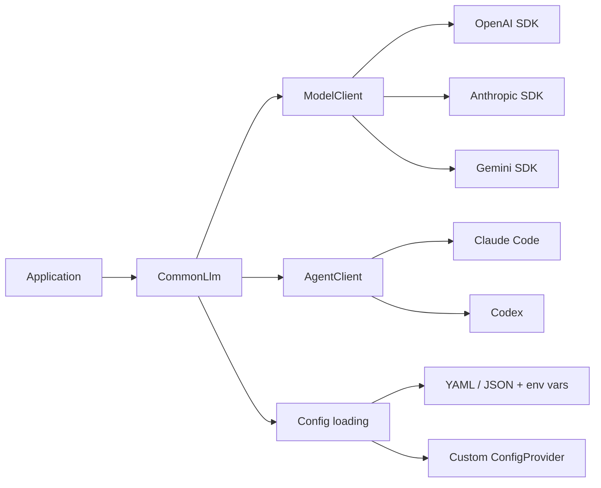

<h1 align="center">common-llm</h1>
<p align="center">A unified client library for LLM APIs and coding agents in Java, Go, Python and TypeScript</p>
<p align="center">English | <a href="README.zh-CN.md">简体中文</a></p>

<div align="center">

     

</div>

## Introduction
common-llm wraps three model APIs (OpenAI, Anthropic and Google Gemini) and two coding agents (Claude Code and Codex) behind one set of request, response, event and error types. The four language implementations are independent of each other but share the same functional contract, so any single language directory can be copied into an existing project and used on its own.

It is a library, not an HTTP gateway or an agent orchestration framework: callers choose the provider and model explicitly, and the library does no automatic routing, billing or retry orchestration.

## Features
- **Unified model calls**: `generate` and `stream` cover text generation, streaming, tool calling, structured output (JSON Schema) and image input.
- **Image generation**: `generateImage` and `streamImage` cover text-to-image and image-to-image for OpenAI (Images API or the Responses `image_generation` tool, selected by `image_api`) and Gemini (native image output), with masks, partial images and multiple images where the vendor supports them.
- **Official SDKs first**: all three model APIs are called through their official SDKs. OpenAI supports both the Responses API and Chat Completions, so OpenAI-compatible endpoints work too.
- **Coding agents**: Claude Code and Codex share `run`, `runStream`, `resume`, `interrupt` and capability queries, with normalized events such as `started`, `message`, `tool_started`, `tool_completed`, `file_changed`, `approval_requested`, `usage` and `completed`.
- **Safe defaults**: approval requests are declined when no handler is provided; Codex runs in a `workspace-write` sandbox with network access off; arguments are passed to subprocesses as arrays, never through a shell; timeouts and cancellation terminate the whole process group.
- **Unified error categories**: 19 fixed categories (such as `AUTH_FAILED`, `RATE_LIMITED`, `CLI_NOT_FOUND`) carrying retriability, vendor error codes and request IDs, with secrets redacted from messages.
- **Flexible configuration**: YAML / JSON config files, `${ENV}` references to environment variables, and pluggable `ConfigProvider` sources (for example a database) with runtime `reload`.
- **No lost vendor features**: `providerOptions` passes native vendor parameters through, and `nativeClient()` exposes the underlying SDK client.

## Architecture


## Support Matrix
| Capability | Java | Go | Python | TypeScript |
|---|---|---|---|---|
| OpenAI (Responses / Chat Completions) | `openai-java` | `openai-go/v3` | `openai` | `openai` |
| Anthropic (Messages) | `anthropic-java` | `anthropic-sdk-go/v2` | `anthropic` | `@anthropic-ai/sdk` |
| Gemini | `google-genai` | `google.golang.org/genai` | `google-genai` | `@google/genai` |
| Image generation (OpenAI / Gemini) | official SDK | official SDK | official SDK | official SDK |
| Claude Code | `claude -p` subprocess | `claude -p` subprocess | `claude-agent-sdk` | `@anthropic-ai/claude-agent-sdk` |
| Codex | `codex app-server` JSON-RPC | `codex app-server` JSON-RPC | `openai-codex` | `@openai/codex-sdk` |

Locked dependency versions for each language are listed in its README.

## Language Directories
| Directory | Package / Coordinates | Version | Runtime |
|---|---|---|---|
| [java](java/README.md) | `io.github.charleshyf:common-llm` (Maven) | 1.0.0 | Java 17+ |
| [golang](golang/README.md) | `github.com/CharlesHYF/common-llm/golang` | v1.0.0 | Go 1.26+ |
| [python](python/README.md) | `common-llm` (import name `common_llm`) | 1.0.0 | Python 3.11+ |
| [typescript](typescript/README.md) | `@charleshyf/common-llm` | 1.0.0 | Node.js 22+ |

The language READMEs are written in Simplified Chinese.

## Quick Start
Create `common-llm.yaml` in your working directory and inject secrets through environment variables:
```yaml
providers:
  openai:
    enabled: true
    api_key: ${OPENAI_API_KEY}
    default_model: ${OPENAI_MODEL}
```

```bash
export OPENAI_API_KEY="sk-..."
export OPENAI_MODEL="<model id>"
```

Install the library as described in the language README, then make a call:

### Java
```java
try (CommonLlm commonLlm = CommonLlm.create()) {
	ModelResponse response = commonLlm.generate(ModelRequest.builder()
		.provider("openai")
		.addMessage(Message.user("Introduce Shanghai in one sentence"))
		.build());
	System.out.println(response.getText());
}
```

### Go
```go
client, err := commonllm.Create(ctx, commonllm.Options{})
if err != nil {
	return err
}
defer client.Close()

response, err := client.Generate(ctx, &core.ModelRequest{
	Provider: "openai",
	Messages: []core.Message{core.TextMessage(core.RoleUser, "Introduce Shanghai in one sentence")},
})
if err != nil {
	return err
}
fmt.Println(response.Text)
```

### Python
```python
llm = CommonLlm.create()
response = await llm.generate(
    ModelRequest(provider="openai", messages=[Message.from_text("user", "Introduce Shanghai in one sentence")])
)
print(response.text)
await llm.close()
```

### TypeScript
```ts
const llm = await CommonLlm.create();
const response = await llm.generate({
	provider: "openai",
	messages: [
		{
			role: "user",
			content: [
				{
					type: "text",
					text: "Introduce Shanghai in one sentence",
				},
			],
		},
	],
});
console.log(response.text);
await llm.close();
```

See the language READMEs for streaming, tool calling, image generation, coding agents, multiple provider instances and more.

## Configuration
- Lookup order: a path passed explicitly in code, then the `COMMON_LLM_CONFIG` environment variable, then `common-llm.yaml` in the working directory.
- Precedence: runtime overrides > injected `ConfigProvider` > config file > defaults. Environment variables only take effect through `${NAME}` and `${NAME:-default}` references; they never override fields implicitly.
- Keys under `providers` are instance names and `type` selects the vendor, so the official OpenAI API and several compatible endpoints can be configured side by side; `api: chat_completions` switches to Chat Completions.
- See `common-llm.example.yaml` in each language directory for every field and its default.

## Error Handling
`generate` throws (or, in Go, returns) a unified error object on failure. `stream`, `run` and `runStream` never throw; failures end with a single terminal event or a result with `status: failed`. Common categories:

| Category | Trigger | Retriable |
|---|---|---|
| `CONFIG_INVALID` | Missing or invalid configuration | No |
| `AUTH_MISSING` / `AUTH_FAILED` | Missing key / invalid key | No |
| `RATE_LIMITED` | Rate limit or local concurrency limit | Yes |
| `QUOTA_EXCEEDED` | Quota exhausted | No |
| `TIMEOUT` | Request or agent run timed out | Yes |
| `PROVIDER_ERROR` | Vendor returned an error; 5xx is retriable | Depends on status |
| `SDK_UNSUPPORTED_FEATURE` | Requested a capability the provider or agent does not support | No |
| `CLI_NOT_FOUND` / `CLI_VERSION_UNSUPPORTED` | CLI not installed / version too old | No |

All 19 categories are listed in the language READMEs.

## Coding Agent Prerequisites
- Claude Code 2.1.325 or later and Codex 0.169.0 or later, available on `PATH` or configured through `executable_path`.
- Without the CLIs the model APIs keep working, and agent calls return `CLI_NOT_FOUND`.
- Products serving third-party users must not reuse a personal subscription login of the CLI; use an API key and follow the vendor terms.

## License
[MIT](LICENSE)
