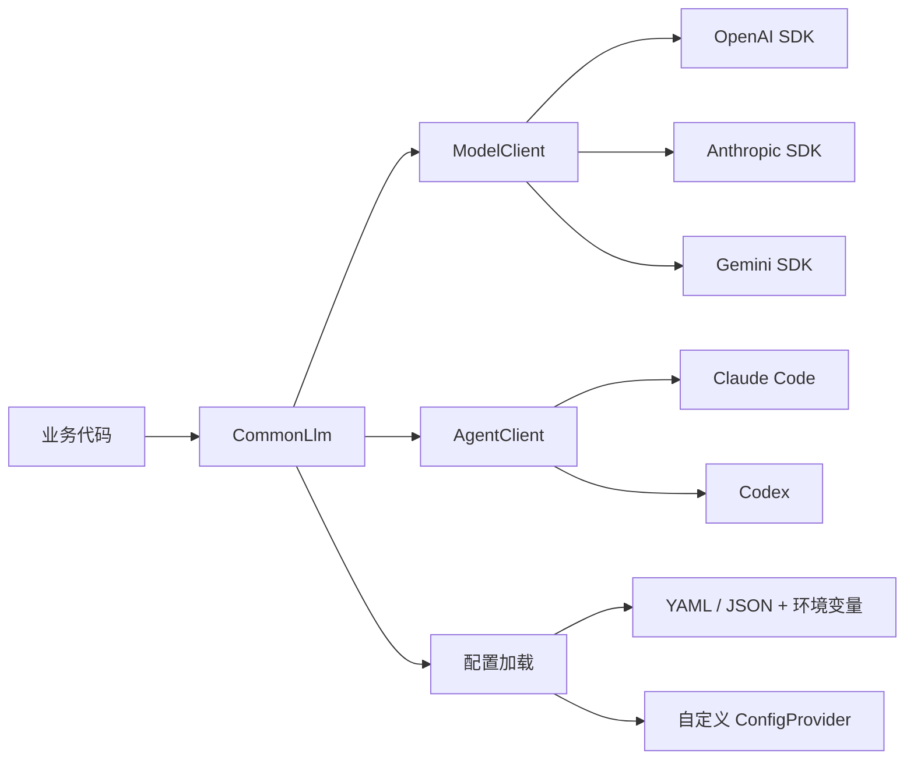

<h1 align="center">common-llm</h1>
<p align="center">面向 Java、Go、Python、TypeScript 的模型 API 与 Coding Agent 统一调用库</p>
<p align="center"><a href="README.md">English</a> | 简体中文</p>

<div align="center">

     

</div>

## 介绍
common-llm 把 OpenAI、Anthropic、Google Gemini 三家模型 API，以及 Claude Code、Codex 两个 Coding Agent，封装成同一套请求、响应、事件与错误结构。四种语言的实现相互独立、功能契约一致，任意一个语言目录都可以单独复制进已有项目使用。

它是一个库，不是 HTTP 网关，也不是 Agent 编排框架：调用方显式指定 Provider 与模型，本库不做自动路由、计费或重试编排。

## 特性
- **统一的模型调用**：`generate` 与 `stream` 覆盖文本生成、流式输出、工具调用、结构化输出（JSON Schema）与图片输入。
- **官方 SDK 优先**：三家模型 API 全部经官方 SDK 调用；OpenAI 同时支持 Responses API 与 Chat Completions，可接入 OpenAI 兼容端点。
- **Coding Agent**：Claude Code 与 Codex 统一提供 `run`、`runStream`、`resume`、`interrupt` 与能力查询，事件统一为 `started`、`message`、`tool_started`、`tool_completed`、`file_changed`、`approval_requested`、`usage`、`completed` 等类型。
- **安全默认值**：审批请求未提供处理器时一律拒绝；Codex 默认 `workspace-write` 沙箱且关闭网络；参数以数组传给子进程，不拼接 shell；超时与取消会结束整个进程组。
- **统一错误分类**：19 个固定分类（如 `AUTH_FAILED`、`RATE_LIMITED`、`CLI_NOT_FOUND`），携带是否可重试、厂商错误码与请求 ID，错误信息自动脱敏。
- **灵活配置**：YAML / JSON 配置文件，`${ENV}` 引用环境变量，可注入数据库等自定义 `ConfigProvider` 并在运行时 `reload`。
- **不丢厂商能力**：`providerOptions` 透传厂商原生参数，`nativeClient()` 直接访问底层 SDK 客户端。

## 架构


## 支持矩阵
| 能力 | Java | Go | Python | TypeScript |
|---|---|---|---|---|
| OpenAI（Responses / Chat Completions） | `openai-java` | `openai-go/v3` | `openai` | `openai` |
| Anthropic（Messages） | `anthropic-java` | `anthropic-sdk-go/v2` | `anthropic` | `@anthropic-ai/sdk` |
| Gemini | `google-genai` | `google.golang.org/genai` | `google-genai` | `@google/genai` |
| Claude Code | `claude -p` 子进程 | `claude -p` 子进程 | `claude-agent-sdk` | `@anthropic-ai/claude-agent-sdk` |
| Codex | `codex app-server` JSON-RPC | `codex app-server` JSON-RPC | `openai-codex` | `@openai/codex-sdk` |

各语言的依赖锁定版本见对应目录的 README。

## 语言目录
| 目录 | 包 / 坐标 | 版本 | 运行时 |
|---|---|---|---|
| [java](java/README.md) | `io.github.charleshyf:common-llm`（Maven） | 1.0.0 | Java 17+ |
| [golang](golang/README.md) | `github.com/CharlesHYF/common-llm/golang` | v1.0.0 | Go 1.26+ |
| [python](python/README.md) | `common-llm`（导入名 `common_llm`） | 1.0.0 | Python 3.11+ |
| [typescript](typescript/README.md) | `@charleshyf/common-llm` | 1.0.0 | Node.js 22+ |

## 快速开始
在工作目录创建 `common-llm.yaml`，密钥通过环境变量注入：
```yaml
providers:
  openai:
    enabled: true
    api_key: ${OPENAI_API_KEY}
    default_model: ${OPENAI_MODEL}
```

```bash
export OPENAI_API_KEY="sk-..."
export OPENAI_MODEL="<模型 ID>"
```

安装方式见各语言 README，然后发起一次调用：

### Java
```java
try (CommonLlm commonLlm = CommonLlm.create()) {
	ModelResponse response = commonLlm.generate(ModelRequest.builder()
		.provider("openai")
		.addMessage(Message.user("用一句话介绍上海"))
		.build());
	System.out.println(response.getText());
}
```

### Go
```go
client, err := commonllm.Create(ctx, commonllm.Options{})
if err != nil {
	return err
}
defer client.Close()

response, err := client.Generate(ctx, &core.ModelRequest{
	Provider: "openai",
	Messages: []core.Message{core.TextMessage(core.RoleUser, "用一句话介绍上海")},
})
if err != nil {
	return err
}
fmt.Println(response.Text)
```

### Python
```python
llm = CommonLlm.create()
response = await llm.generate(
    ModelRequest(provider="openai", messages=[Message.from_text("user", "用一句话介绍上海")])
)
print(response.text)
await llm.close()
```

### TypeScript
```ts
const llm = await CommonLlm.create();
const response = await llm.generate({
	provider: "openai",
	messages: [
		{
			role: "user",
			content: [
				{
					type: "text",
					text: "用一句话介绍上海",
				},
			],
		},
	],
});
console.log(response.text);
await llm.close();
```

流式输出、工具调用、Coding Agent、多 Provider 实例等用法见各语言 README。

## 配置
- 查找顺序：代码中显式传入的路径，其次环境变量 `COMMON_LLM_CONFIG`，最后是工作目录下的 `common-llm.yaml`。
- 优先级：运行时覆盖 > 注入的 `ConfigProvider` > 配置文件 > 默认值。环境变量只通过 `${NAME}`、`${NAME:-default}` 引用生效，不会自动覆盖字段。
- `providers` 的键是实例名，`type` 指定厂商，可以同时配置官方 OpenAI 与多个兼容端点；`api: chat_completions` 切换到 Chat Completions。
- 完整字段与默认值见各语言目录的 `common-llm.example.yaml`。

## 错误处理
`generate` 失败时抛出（Go 返回）统一的错误对象；`stream`、`run`、`runStream` 不抛异常，失败以唯一的终止事件或 `status: failed` 的结果返回。常用分类：

| 分类 | 触发条件 | 可重试 |
|---|---|---|
| `CONFIG_INVALID` | 配置缺失或取值非法 | 否 |
| `AUTH_MISSING` / `AUTH_FAILED` | 缺少密钥 / 密钥无效 | 否 |
| `RATE_LIMITED` | 限流或本地并发上限 | 是 |
| `QUOTA_EXCEEDED` | 额度耗尽 | 否 |
| `TIMEOUT` | 请求或 Agent 运行超时 | 是 |
| `PROVIDER_ERROR` | 厂商返回错误，5xx 可重试 | 视状态码 |
| `SDK_UNSUPPORTED_FEATURE` | 请求了当前 Provider / Agent 不支持的能力 | 否 |
| `CLI_NOT_FOUND` / `CLI_VERSION_UNSUPPORTED` | 未安装 CLI / 版本过低 | 否 |

完整的 19 个分类见各语言 README。

## Coding Agent 前置条件
- Claude Code 2.1.325 及以上、Codex 0.169.0 及以上，可执行文件需在 `PATH` 中或通过 `executable_path` 指定。
- 未安装 CLI 时模型 API 照常可用，Agent 调用返回 `CLI_NOT_FOUND`。
- 面向第三方用户的产品不得复用个人订阅的 CLI 登录，应使用 API key 并遵守厂商条款。

## 许可证
[MIT](LICENSE)
